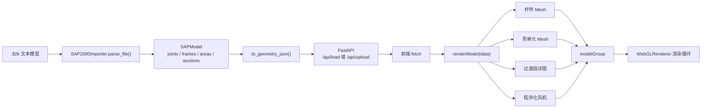
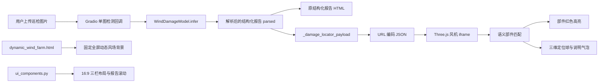

# WTA 风电模型 3D 渲染构建实现说明

> 本文以现有风电三维可视化工具（visualizetool）的实现为蓝本，基于 `static/index.html`（Three.js 前端）、`parser/sap2000_parser.py`（几何数据解析）与 `app.py`（数据接口）编写，说明桁架式风电支撑结构从 SAP2000 文本模型到浏览器三维场景的完整构建方式，供 WTA 风电评估模型完善时借鉴。
>
> 对应版本：v0.5.0 交付版 ｜ 最后更新：2026-11-11

---

## 1. 目标与范围

本工具将 SAP2000 导出的 `.$2k` 文本模型转换为浏览器中的三维风电支撑结构，包含：

- 桁架段：塔柱（leg）、横杆（horizontal）、斜杆（diagonal）、横隔（diagonal2）
- 塔筒段：圆管 / 方管 / 非棱柱渐变段
- 过渡段：插入式变截面箱梁、法兰环、顶环梁；壳体过渡段（AREA 壳单元）
- 程序化演示风机：机舱、旋流锥轮毂、3 支带扭角叶片
- 交互：轨道控制、部件显隐、叶轮自转、偏航转动、视角重置、信息卡统计

渲染层不依赖任何构建工具，全部逻辑集中在 `static/index.html` 的 `<script type="module">` 中；Three.js 以本地 `importmap` 方式加载，可离线运行。

---

## 2. 总体架构



关键分层：

| 层 | 文件 | 职责 |
|---|---|---|
| 解析层 | `parser/sap2000_parser.py` | 解析 TABLE 文本、单位换算、截面分类、输出几何 JSON |
| 接口层 | `app.py` | 本地模型列表、按名加载、上传解析、静态资源挂载 |
| 渲染层 | `static/index.html` | 场景、几何、材质、动画、UI 与交互 |

---

## 3. 输入数据契约

前端 `renderModel(data)` 消费的 JSON 主要字段：

```json
{
  "model_name": "160-10MW_xie_4leg",
  "params": { "tower_height": 160.0, "base_width": 32.5 },
  "nodes": [
    { "id": 1, "x": 0.0, "y": 0.0, "z": 0.0 }
  ],
  "members": [
    { "id": 1, "node_i": 1, "node_j": 2, "section": "Leg0", "type": "leg" }
  ],
  "areas": [
    { "id": 1, "joints": [1, 2, 3, 4], "section": "tp01", "type": "transition", "thickness_mm": 30 }
  ],
  "sections": [
    {
      "name": "Leg0", "shape": "Pipe",
      "t3": 1100.0, "t2": 0.0, "tw": 27.0, "tf": 0.0,
      "area": 910.0, "is_nonprismatic": false,
      "start_sect": "", "end_sect": ""
    }
  ],
  "stats": { "num_joints": 113, "num_frames": 208, "type_counts": { "leg": 4 } },
  "db_meta": { "weight": 356.2, "note": "插入式" }
}
```

字段约定：

- `nodes[].x/y/z`：单位 **米**，`z` 为竖直高度方向（SAP2000 坐标系）。
- `sections[].t2/t3/tw/tf`：单位 **毫米**；`area`：单位 **cm²**。
- `members[].type`：`leg / horizontal / diagonal / diagonal2 / tube / transition / rigid / other / foundation`。
- `areas[].thickness_mm`：壳单元厚度，毫米。
- `foundation` 类型在前端默认不渲染。

---

## 4. 渲染主流程

`renderModel(data)` 是唯一入口，执行顺序如下：

1. `modelGroup.clear()` 清空上一模型，并重置风机引用。
2. 建立 `sectionsMap`（截面名 → 截面）与 `nodeById`（节点 ID → 节点）。
3. 预解析非棱柱截面的起止子截面尺寸，写入 `section._t2a/_t3a/_t2b/_t3b`。
4. 遍历节点，计算整体包围盒 `minX/maxX/...`。
5. 节点数 ≤ 400 时绘制节点球。
6. 遍历杆件，逐根生成几何、材质、位置与朝向，加入 `modelGroup`。
7. 按类型合并壳单元三角形，生成半透明双面 Mesh。
8. 构建插入式过渡段工程详图（法兰环、顶环梁）。
9. 计算塔筒段高度、过渡段高度，推导叶片长度。
10. 在塔顶构建程序化风机，并挂到偏航组 `yawPivot`。
11. 应用塔高缩放系数，重建地面网格。
12. 自动定位相机与 `OrbitControls.target`。
13. 计算并填充三张模型信息卡，更新状态栏。

源码位置：`static/index.html` 第 479–702 行。

---

## 5. 坐标系、单位与尺度

### 5.1 坐标转换

SAP2000 使用 `x, y` 水平、`z` 竖向；Three.js 使用 `y` 向上。前端统一转换：

```js
const toV3 = (n) => new THREE.Vector3(n.x, n.z, n.y);
```

即：

```text
Three.js (x, y, z) = SAP2000 (x, z, y)
```

该转换在节点球、杆件端点、壳单元顶点、包围盒、塔顶中心、过渡段详图中保持一致。

### 5.2 单位换算

- 解析器：坐标 in → m（×0.0254），截面尺寸 in → mm（×25.4），面积 in² → cm²，惯矩 in⁴ → cm⁴。
- 渲染器：截面尺寸 `mm / 1000 → m`；构件长度直接使用节点米制距离。
- 重量：`截面面积(cm²) × 1e-4 × 长度(m) × 7850 kg/m³`。

### 5.3 全局缩放

```js
function scaleFactor(height) {
    if (height > 100) return 0.5;
    if (height > 50) return 0.8;
    return 1.0;
}
```

`modelGroup.scale.setScalar(scale)` 对杆件、壳单元、过渡段详图、风机整体统一缩放。缩放只影响显示，不改变原始坐标数据。

---

## 6. 场景与相机初始化

### 6.1 渲染器

```js
const renderer = new THREE.WebGLRenderer({ antialias: true });
renderer.setPixelRatio(Math.min(window.devicePixelRatio, 2));
renderer.setSize(window.innerWidth, window.innerHeight);
renderer.shadowMap.enabled = true;
```

- `pixelRatio` 上限 2，避免高分屏下像素量过大。
- 开启阴影贴图；杆件 Mesh 同时设置 `castShadow` 与 `receiveShadow`。

### 6.2 场景与相机

```js
const scene = new THREE.Scene();
scene.background = new THREE.Color(0xf0f4f8);

const camera = new THREE.PerspectiveCamera(50, aspect, 0.1, 5000);
camera.position.set(120, 80, 120);

const controls = new OrbitControls(camera, renderer.domElement);
controls.enableDamping = true;
controls.dampingFactor = 0.08;
controls.target.set(0, 30, 0);
```

浅色主题背景 `#F0F4F8`，与页面 CSS 变量一致。

### 6.3 灯光

| 光源 | 颜色 | 强度 | 位置 | 作用 |
|---|---|---|---|---|
| `DirectionalLight` | `#FFFFFF` | 1.5 | (80, 200, 60) | 主光，塑造杆件体积感 |
| `DirectionalLight` | `#BFD4E8` | 0.9 | (-60, 40, -80) | 冷色补光，压暗面不过黑 |
| `AmbientLight` | `#FFFFFF` | 0.55 | — | 整体提亮，适配浅色背景 |

浅色背景下采用“强环境光 + 中等方向光”的组合，避免深色阴影破坏清爽界面。

### 6.4 地面网格

初始化时使用 `GridHelper(100, 50)` 占位；模型加载后按包围盒重建：

```js
const span = Math.max(maxX - minX, maxY - minY, maxZ - minZ, 1) * scale;
const gridHelper = new THREE.GridHelper(Math.max(span * 2.5, 20), 40, GRID_COLOR1, GRID_COLOR2);
gridHelper.position.set(cx, minY * scale - 0.5, cz);
```

网格始终落在模型最低点下方 0.5m，并随模型中心平移。

---

## 7. 模型预处理

### 7.1 索引表

```js
const sectionsMap = {};
for (const s of (data.sections || [])) sectionsMap[s.name] = s;

const nodeById = {};
for (const n of nodes) nodeById[n.id] = n;
```

杆件通过 `m.section` 查截面，通过 `m.node_i / m.node_j` 查端点，避免 O(n²) 遍历。

### 7.2 非棱柱截面预解析

非棱柱截面本身只有 `start_sect / end_sect` 引用，没有直接尺寸。渲染前把两端子截面尺寸缓存到主截面：

```js
for (const s of (data.sections || [])) {
    if (s.is_nonprismatic && s.start_sect && s.end_sect) {
        const a = sectionsMap[s.start_sect], b = sectionsMap[s.end_sect];
        if (a && b) {
            s._t2a = a.t2 || 0; s._t3a = a.t3 || 0;
            s._t2b = b.t2 || 0; s._t3b = b.t3 || 0;
        }
    }
}
```

前缀 `_` 表示前端派生字段，不参与后端 JSON 契约。

### 7.3 包围盒

遍历所有节点并转换到 Three.js 坐标，得到 `minX/maxX/minY/maxY/minZ/maxZ`，用于：

- 节点球显隐阈值判断之外的尺度计算
- `span` 计算
- 相机定位
- 地面网格定位

---

## 8. 杆件几何构建

### 8.1 几何工厂分发

`makeMemberGeometry(section, len)` 根据截面形状返回沿 **局部 Y 轴**、长度为 `len` 的几何体：

| 截面形状 | 几何体 | 参数 |
|---|---|---|
| `Pipe / Tube / Circle` | `CylinderGeometry(r, r, len, 10)` | `r = t3 / 2` |
| `Box / Rect` | `BoxGeometry(w, len, h)` | `w = t2`，`h = t3` |
| 非棱柱 Box/Rect | 自定义 `makeTaperedBox()` 棱台 | 两端 `t2/t3` |
| 非棱柱 Pipe/Tube | `CylinderGeometry(rTop, rBot, len, 12)` | 两端 `t3/2` |
| 缺失截面 | `CylinderGeometry(0.04, 0.04, len, 6)` | 兜底细杆 |

关键判定顺序：

```js
// ⚠️ box 判断必须在 tube 之前
if (shape.includes('box') || shape.includes('rect')) { ... }
if (shape.includes('pipe') || shape.includes('tube') || shape.includes('circle')) { ... }
```

因为 `"Box/Tube"` 字符串同时包含 `box` 与 `tube`，若先判断 `tube` 会被误渲染为圆柱（v0.4.2 修复点）。

最小尺寸兜底：

```js
const FALLBACK_R = 0.04;
const w = Math.max(t2 || t3, FALLBACK_R * 2);
const h = Math.max(t3, FALLBACK_R * 2);
const r = Math.max(t3 / 2, FALLBACK_R);
```

防止异常小截面退化为不可见或零体积几何。

### 8.2 变截面棱台 `makeTaperedBox`

用于 TPBeam 插入式过渡梁、非棱柱箱形截面。手工构造 8 个顶点与 12 个三角形：

```js
const v = [
    -xa, -h, -ya,   xa, -h, -ya,   xa, -h, ya,   -xa, -h, ya,   // 小端 0-3
    -xb,  h, -yb,   xb,  h, -yb,   xb,  h, yb,   -xb,  h,  yb,   // 大端 4-7
];
const idx = [
    0,1,2, 0,2,3,      // 小端面
    4,6,5, 4,7,6,      // 大端面
    0,4,5, 0,5,1,      // -x 侧面
    1,5,6,1,6,2,       // +x 侧面
    2,6,7,2,7,3,       // +z 侧面
    3,7,4,3,4,0,       // -z 侧面
];
```

几何沿局部 Y 轴拉伸，小端在 `-h`，大端在 `+h`，并标记：

```js
geom.userData.verticalSection = true;
```

该标记供后续“截面竖直统一”旋转逻辑与过渡段 2.5m 延伸逻辑识别。

### 8.3 杆件定位与朝向

每根杆件取两端点：

```js
const mid = start.clone().add(end).multiplyScalar(0.5);
const dir = end.clone().sub(start);
const len = dir.length();
const dirN = dir.normalize();
```

普通杆件使用单位向量对齐：

```js
mesh.position.copy(mid);
mesh.quaternion.setFromUnitVectors(new THREE.Vector3(0, 1, 0), dirN);
```

即把几何的局部 +Y 轴旋转到杆件实际方向。

### 8.4 截面竖直统一（棱台专用）

插入式箱梁要求在任意杆件朝向下，截面“高度方向”始终尽量竖直、“宽度方向”保持水平：

```js
const yUp = new THREE.Vector3(0, 1, 0).addScaledVector(dirN, -dirN.y).normalize();
if (yUp.lengthSq() < 1e-8) yUp.set(0, 0, 1);   // 杆件接近竖直时的退化处理
const xAxis = new THREE.Vector3().crossVectors(dirN, yUp).normalize();
mesh.quaternion.setFromRotationMatrix(
    new THREE.Matrix4().makeBasis(xAxis, dirN, yUp)
);
```

步骤：

1. 将世界竖直向量投影到垂直于杆轴的平面，得到截面高度方向 `yUp`。
2. 杆轴 `dirN` 与 `yUp` 叉乘得到水平宽度方向 `xAxis`。
3. 用 `xAxis / dirN / yUp` 构造基矩阵，作为 Mesh 的四元数。

这样箱梁不会随杆件倾斜而发生截面“翻滚”。

### 8.5 过渡段大端延伸 2.5m

插入式过渡段只向大端（塔筒侧）延伸 2.5m，用于插入塔筒：

```js
const EX_LO = 0.0, EX_HI = 2.5;
geom = makeTaperedBox(..., len + EX_LO + EX_HI);
extendShift = (EX_HI - EX_LO) / 2;
...
mesh.position.addScaledVector(dirN, extendShift);
```

注意单位：`section._t2a/_t3a` 为毫米，传入 `makeTaperedBox` 前必须 `/1000` 转米。

### 8.6 材质与类型着色

每根杆件创建独立 `MeshStandardMaterial`：

```js
const mat = new THREE.MeshStandardMaterial({
    color: TYPE_COLORS[m.type] || TYPE_COLORS['other'],
    roughness: 0.5,
    metalness: 0.15,
});
```

颜色映射：

| 类型 | 颜色 | 说明 |
|---|---|---|
| `leg` | `0xD98A1F` 橙 | 塔柱 |
| `diagonal` | `0x2B8FD9` 蓝 | 斜腹杆 |
| `horizontal` | `0x2EA35C` 绿 | 横杆 |
| `diagonal2` | `0x8E54C9` 紫 | 横隔/副斜杆 |
| `tube` | `0xD9573F` 红橙 | 塔筒段 |
| `transition` | `0xD9A113` 黄 | 过渡段 |
| `rigid` | `0x8A8F98` 灰 | 刚性杆 |
| `other` | `0x5B7A94` 灰蓝 | 其他 |
| `foundation` | `0x9AA5B1` 灰 | 混凝土基础，默认不渲染 |

`mesh.userData.memberType = m.type` 为后续部件显隐提供类型标记。

---

## 9. 壳单元（AREA）渲染

壳体过渡段（如 qiaoti 塔）由四边形/三角形壳单元构成。实现方式：

1. 按类型收集三角形顶点到 `areaVerts[type]`。
2. 四边形拆成两个三角形：`(0,1,2)` 与 `(0,2,3)`。
3. 同类型所有三角形合并进一个 `BufferGeometry`，减少 draw call。
4. 使用半透明双面材质：

```js
const mat = new THREE.MeshStandardMaterial({
    color: TYPE_COLORS[atype] || TYPE_COLORS['transition'],
    transparent: true,
    opacity: 0.45,
    side: THREE.DoubleSide,
    roughness: 0.6,
    metalness: 0.1,
    depthWrite: false,
});
```

`depthWrite: false` 避免半透明面片相互遮挡产生脏边；`DoubleSide` 保证从内外两侧观察都可见。

壳单元同样写入 `userData.memberType`，受“过渡段”勾选框控制。

---

## 10. 插入式过渡段工程详图

`buildTransitionDetail(data, nodeById, group)` 仅对“过渡段杆件截面为 Box/Rect”的插入式塔生效。120m 圆管过渡、qiaoti 壳体过渡不会触发。

### 10.1 触发条件

```js
if (sh.includes('box') || sh.includes('rect')) { isInsert = true; ts = s; break; }
```

### 10.2 组成构件

| 构件 | 几何 | 位置 / 参数 |
|---|---|---|
| 变截面箱梁 | `makeTaperedBox` | 由主渲染流程按杆件生成，大端延伸 2.5m |
| 塔筒底法兰环 | `TorusGeometry(rTop, 0.45, 12, 40)` | `(0, tHi, 0)`，绕 X 轴旋转 90° |
| 桁架顶环梁 | 相邻角点间 `BoxGeometry(bw, bh, len)` | 位于 `tLo` 平面，按极角排序连接 |

### 10.3 法兰环

```js
if (rTop > 0.5) {
    const flange = new THREE.Mesh(
        new THREE.TorusGeometry(rTop, 0.45, 12, 40),
        new THREE.MeshStandardMaterial({ color: 0x8a8f98, roughness: 0.45, metalness: 0.5 })
    );
    flange.rotation.x = Math.PI / 2;
    flange.position.set(0, tHi, 0);
    flange.userData.memberType = 'transition';
    group.add(flange);
}
```

- `rTop`：过渡段高端节点到塔轴的最大水平半径。
- 环截面半径固定 0.45m，材质为高金属度钢环。

### 10.4 顶环梁

1. 取过渡段低端 `tLo` 平面上、水平半径 `> 0.5m` 的节点（排除中心节点）。
2. 按 `atan2(y, x)` 极角排序。
3. 相邻节点两两连线，每边生成一根箱梁。
4. 截面尺寸取过渡段截面 `t2 × t3`（mm → m），带最小值兜底：

```js
const bw = (ts && ts.t2) ? Math.max(ts.t2 / 1000, 0.08) : 1.6;
const bh = (ts && ts.t3) ? Math.max(ts.t3 / 1000, 0.08) : 2.843;
```

5. 箱梁局部 +Z 对齐连线方向：

```js
beam.quaternion.setFromUnitVectors(new THREE.Vector3(0, 0, 1), dir.normalize());
```

所有详图构件均标记为 `transition`，受右侧“过渡段”显隐控制。

---

## 11. 程序化演示风机

风机不是模型构件，而是塔顶程序化生成的 Three.js 组合体，挂入 `modelGroup` 随模型统一缩放。

### 11.1 坐标系与尺寸策略

- 转子轴沿世界 **X** 方向，迎风面朝 `+X`（默认相机一侧）。
- 叶片在 **YZ 平面**内径向伸展，绕 X 轴旋转。
- 轮毂、机舱、转子位置采用 120m 塔固定值，不随塔高二次缩放。
- 叶片长度由各塔塔筒段实测高度推导。

固定参数：

| 参数 | 值 | 含义 |
|---|---|---|
| `hubR` | 1.9212 m | 轮毂半径 |
| `nacelleR` | 1.7675 m | 机舱半径 |
| `nacelleL` | 10.182 m | 机舱长度 |
| `AXIS_DY` | -1.2325 m | 转子轴线相对塔顶面的高度偏移 |
| `ROTOR_DX` | 6.7982 m | 转子平面相对塔顶中心的前移量 |

### 11.2 机舱：水平胶囊

由“圆柱 + 前后半球封头”组成：

```js
const nCyl = new THREE.Mesh(new THREE.CylinderGeometry(nacelleR, nacelleR, nacelleL, 24), grayMat);
nCyl.rotation.z = Math.PI / 2;   // 圆柱轴 y → x
```

- 前半球：`SphereGeometry(..., 0, PI*2, 0, PI/2)`，旋转后位于 `+x` 端。
- 后半球：同理位于 `-x` 端。
- 三段共用 `grayMat`，保证接缝处颜色一致。

### 11.3 轮毂：LatheGeometry 旋流锥

```js
const SL = hubR * 2.85;
const spinnerPts = [];
for (let i = 0; i <= 12; i++) {
    const t = i / 12;
    spinnerPts.push(new THREE.Vector2(
        hubR * Math.pow(Math.cos(t * Math.PI / 2), 0.8),
        t * SL
    ));
}
const spinner = new THREE.Mesh(new THREE.LatheGeometry(spinnerPts, 28), grayMat);
spinner.rotation.z = -Math.PI / 2;
```

- 轮廓半径按 `cos^0.8` 收敛，形成饱满且略内凹的旋流锥。
- `LatheGeometry` 绕局部 Y 轴旋转成面；再绕 Z 轴 -90°，使鼻尖朝 `+X`。

### 11.4 叶片：轮廓挤出 + 逐顶点扭角

叶片分四步构建：

1. **平面轮廓**：在 XY 平面绘制前缘、后缘、叶根、叶尖。
2. **挤出厚度**：`ExtrudeGeometry` 沿 Z 挤出，并居中。
3. **逐顶点扭角**：叶根 38° → 叶尖 6°。
4. **轴向变换**：展向 → +Y，弦向 → Z，厚度 → X。

轮廓：

```js
const u0 = hubR * 0.55;              // 叶根起点（藏入旋流锥）
const maxChord = bladeLen * 0.085;   // 最大弦长
const rootChord = bladeLen * 0.045;  // 叶根弦长
const thick = maxChord * 0.16;       // 挤出厚度

shape.moveTo(u0, rootChord * 0.5);
shape.quadraticCurveTo(bladeLen * 0.25, maxChord * 0.62, bladeLen, 0);
shape.quadraticCurveTo(bladeLen * 0.28, -maxChord * 0.5, u0, -rootChord * 0.5);
shape.closePath();
```

扭角：

```js
const pitchRoot = THREE.MathUtils.degToRad(38);
const pitchTip  = THREE.MathUtils.degToRad(6);
for (let k = 0; k < pos.count; k++) {
    const u = pos.getX(k);
    const s = THREE.MathUtils.clamp((u - u0) / (bladeLen - u0), 0, 1);
    const a = pitchRoot + (pitchTip - pitchRoot) * s;
    const v = pos.getY(k), w = pos.getZ(k);
    pos.setY(k, v * Math.cos(a) - w * Math.sin(a));
    pos.setZ(k, v * Math.sin(a) + w * Math.cos(a));
}
```

即绕展向轴（局部 X）旋转弦向/厚度坐标，实现从叶根到叶尖的连续变桨。

轴向变换：

```js
geom.rotateX(Math.PI / 2);
geom.rotateZ(Math.PI / 2);
```

最终局部坐标：`+Y` 为展向、`Z` 为弦向、`X` 为厚度。

三支叶片绕转子轴均布：

```js
blade.rotation.x = i * Math.PI * 2 / 3;
rotor.add(blade);
```

叶尖红色标识：

```js
const tip = new THREE.Mesh(
    new THREE.BoxGeometry(thick * 1.8, bladeLen * 0.04, maxChord * 0.24),
    tipMat
);
tip.position.y = bladeLen * 0.965;
blade.add(tip);
```

### 11.5 装配与安全间距

```js
turbine.position.set(topCenter.x + 1.0, topCenter.y + AXIS_DY, topCenter.z);
rotor.position.x = ROTOR_DX;
turbine.add(nacelle);
turbine.add(rotor);
```

- 风机整体再向 `+X` 偏移 1m（v0.4.4），避免部分模型叶片扫过塔筒。
- 轴线在塔顶面下方 1.2325m，使机舱坐入塔筒顶口。
- 转子平面前移 6.7982m，轮毂底面与机舱前端衔接。

### 11.6 叶片长度推导

叶片长度不是固定值，而是由塔筒段与过渡段实测高度决定：

```js
let lo = Infinity, hi = -Infinity;
for (const m of members) {
    if (m.type !== 'tube') continue;
    lo = Math.min(lo, a.z, b.z);
    hi = Math.max(hi, a.z, b.z);
}
// 过渡段高度同时统计 transition 杆件与 transition 壳单元
const transH = ...;
bladeLen = (hi - lo) - transH - 1;   // 叶尖停在过渡段顶之上 1m

if (!(bladeLen > 20)) bladeLen = height > 150 ? 114.5 : 73.2;
```

设计意图：叶片扫掠圆最低点始终高于过渡段顶部 1m，避免叶片扫塔。

### 11.7 塔顶中心与塔筒轴线

- 塔顶中心：所有最高节点（`|y - maxY| < 1e-6`）的 `x/z` 平均值。
- 塔筒中心轴：所有 `tube` 杆件两端节点的 `x/z` 平均值。

```js
turbine = buildWindTurbine(
    new THREE.Vector3(topX / topCount, maxY, topZ / topCount),
    bladeLen
);
```

偏航组 `yawPivot` 放在塔筒轴线上，风机改为相对偏移，保证旋转时世界位置连续。

---

## 12. 叶轮自转与偏航

### 12.1 层次结构

```text
modelGroup
└── yawPivot                  // 绕塔筒竖直轴 yaw
    └── windTurbine           // 机舱 + rotor
        ├── nacelle
        └── rotor             // 绕 X 轴自转
            ├── spinner
            ├── blade 0
            ├── blade 1
            └── blade 2
```

### 12.2 偏航组构建

```js
yawPivot = new THREE.Group();
yawPivot.position.set(tubeCx, 0, tubeCz);
windTurbine.position.x -= yawPivot.position.x;
windTurbine.position.z -= yawPivot.position.z;
yawPivot.add(windTurbine);
modelGroup.add(yawPivot);
```

先记录风机世界位置，再减去 pivot 偏移，转为局部坐标；旋转 pivot 时风机整体绕塔筒轴线画圆。

### 12.3 动画循环

```js
const _dt = Math.min((_now - _lastT) / 1000, 0.1);
if (windRotor && windSpinning && PART_VIS.wind) {
    windRotor.rotation.x += 1.0 * _dt;      // 叶轮 1 rad/s ≈ 6.3s/圈
}
if (yawPivot && yawSpinning && PART_VIS.wind) {
    yawPivot.rotation.y += 0.2 * _dt;       // 偏航 0.2 rad/s ≈ 31s/圈
}
```

- 使用 `deltaTime` 驱动，帧率无关。
- `Math.min(..., 0.1)` 限制单帧最大步长，防止切后台回来后突跳。
- 两个开关独立：`windSpinning` 控制叶片自转，`yawSpinning` 控制整体偏航。
- 风机隐藏时（`PART_VIS.wind === false`）同时停止两类动画。

---

## 13. 部件显隐系统

状态对象：

```js
const PART_VIS = { wind: true, tube: true, framed: true, trans: true };
const FRAMED_TYPES = new Set(['leg', 'horizontal', 'diagonal', 'diagonal2', 'rigid']);

function updatePartVisibility() {
    modelGroup.traverse((obj) => {
        if (!obj.isMesh) return;
        const mt = obj.userData.memberType;
        if (!mt) return;   // 节点球等无类型构件不受控
        if (mt === 'tube') obj.visible = PART_VIS.tube;
        else if (mt === 'transition') obj.visible = PART_VIS.trans;
        else if (FRAMED_TYPES.has(mt)) obj.visible = PART_VIS.framed;
    });
    if (windTurbine) windTurbine.visible = PART_VIS.wind;
}
```

映射关系：

| 勾选框 | 控制的 `memberType` |
|---|---|
| 风机 | `windTurbine` 整体 |
| 塔筒段 | `tube` |
| 桁架段 | `leg / horizontal / diagonal / diagonal2 / rigid` |
| 过渡段 | `transition`（含杆件、壳单元、法兰、环梁） |

节点球不写入 `memberType`，因此不受部件显隐影响；`foundation` 杆件在渲染阶段直接被跳过。

---

## 14. 相机自适应与视角控制

模型加载完成后：

```js
const cx = (minX + maxX) / 2, cz = (minZ + maxZ) / 2;
const cy = (minY + maxY) / 2;
const span = Math.max(maxX - minX, maxY - minY, maxZ - minZ, 1) * scale;

controls.target.set(cx, cy * scale + span * 0.25, cz);
const dist = span * 2.4;

camera.position.set(
    cx + dist * 0.72,
    cy * scale + dist * 0.55,
    cz + dist * 0.78
);
camera.near = dist / 200;
camera.far = dist * 20;
camera.updateProjectionMatrix();
controls.update();
```

设计要点：

- `target` 上移 `span * 0.25`，为塔顶风机（叶片长度接近塔筒段）留出画面空间。
- 距离系数 `2.4`，确保叶片竖直朝上的极端姿态也能完整入画。
- `near/far` 随模型尺度动态调整，避免大模型深度精度不足或小模型被裁剪。
- 重置视角按钮使用包围盒重新构图：

```js
const box = new THREE.Box3().setFromObject(modelGroup);
const center = box.getCenter(new THREE.Vector3());
const size = box.getSize(new THREE.Vector3());
controls.target.copy(center);
camera.position.copy(center).add(size.multiplyScalar(1.2));
```

---

## 15. 模型信息卡数据计算

`computeCardData(data)` 在纯前端完成统计，不依赖后端二次计算。

### 15.1 几何统计

| 指标 | 算法 |
|---|---|
| 总高度 | `params.tower_height`（解析器取所有节点最大 z） |
| 桁架段高度 | 所有 `leg` 杆件 z 范围 |
| 塔筒高度 | 所有 `tube` 杆件 z 范围 |
| 过渡段高度 | `transition` 杆件 + 壳单元 z 范围 |
| 根开 | 最低节点层 `x/y` 跨度最大值 |
| 边数 | 最低节点层节点数 |

### 15.2 重量统计

```js
w += memberLen(m) * s.area * 1e-4 * STEEL_DENSITY;  // cm² → m²
```

- `STEEL_DENSITY = 7850 kg/m³`。
- 壳单元按三角形面积 × 厚度 × 密度累加（`shellWeight`）。
- 分三组：桁架段、过渡段、塔筒段；总用钢量为三段之和。

### 15.3 截面格式化与合并

```js
// Pipe → Φ1100×27
// Box  → □200×200×5
const fmtSection = s => { ... };
```

同类截面按外形合并壁厚，例如 `Φ1100×27/24/23/20`，避免信息卡过长。

### 15.4 权威元数据覆盖

若后端返回 `db_meta`（来自 `LatticTowerDatabase/桁架塔截面尺寸汇总.md`），则：

- 桁架段重量以 `db_meta.weight` 为准。
- 过渡段形式按 `db_meta.note` 映射：`插入式 / 壳体过渡 / 特殊式`。
- 无 `db_meta` 时回退到前端计算结果。

---

## 16. 渲染循环与性能策略

### 16.1 渲染循环

```js
function animate() {
    requestAnimationFrame(animate);
    const _now = performance.now();
    const _dt = Math.min((_now - _lastT) / 1000, 0.1);
    _lastT = _now;

    if (windRotor && windSpinning && PART_VIS.wind) windRotor.rotation.x += 1.0 * _dt;
    if (yawPivot && yawSpinning && PART_VIS.wind) yawPivot.rotation.y += YAW_SPEED * _dt;

    controls.update();
    renderer.render(scene, camera);
}
animate();
```

### 16.2 已采用的优化

| 策略 | 实现 |
|---|---|
| 像素比上限 | `Math.min(devicePixelRatio, 2)` |
| 节点球阈值 | 节点数 > 400 时不创建节点球 |
| 节点球复用 | 所有节点共用同一 `SphereGeometry` 与 `MeshStandardMaterial` |
| 壳单元合并 | 同类型壳三角形合并为单个 `BufferGeometry` |
| 索引查表 | `nodeById` / `sectionsMap` O(1) 查找 |
| 帧率无关动画 | `deltaTime` 驱动 |
| 半透明深度写入关闭 | 壳单元 `depthWrite: false`，减少透明排序问题 |

### 16.3 可继续优化的点

- **资源释放**：`modelGroup.clear()` 只移除子对象，未调用 `geometry.dispose()` / `material.dispose()`，反复加载大模型可能累积显存。可在清空时遍历释放。
- **材质复用**：当前每根杆件新建一个 `MeshStandardMaterial`。可按“类型 + 截面”缓存材质，显著降低材质数量与状态切换。
- **杆件合批**：同类型杆件可合并为 `InstancedMesh` 或 `BufferGeometryUtils.mergeGeometries`，减少 draw call。
- **阴影开销**：所有杆件 `castShadow + receiveShadow`，大模型下可只让主结构投射阴影或关闭阴影。

---

## 17. 调试与自检句柄

页面暴露 `window.__VT`，便于无头浏览器或控制台检查渲染状态：

```js
window.__VT = {
    get windTurbine() { ... },
    get windRotor() { ... },
    get yawPivot() { ... },
    get windSpinning() { ... },
    get yawSpinning() { ... },
    get modelGroup() { ... },
    get scene() { ... },
    get camera() { ... },
    get renderer() { ... },
    get controls() { ... },
    get showWind() { ... },
    get THREE() { ... },
};
```

典型用途：

- 读取 `renderer.info.render` 对账 draw call / 三角形数量。
- 投影关键节点到 NDC，验证模型是否在视锥内。
- 直接调用 `__VT.camera`、`__VT.controls` 调整视角截图。
- 检查 `windTurbine` / `yawPivot` 的变换是否符合预期。

---

## 18. 关键参数速查

| 参数 | 值 | 位置 |
|---|---|---|
| 场景背景 | `0xF0F4F8` | 场景初始化 |
| 相机 FOV | 50° | 相机初始化 |
| 相机初始位置 | `(120, 80, 120)` | 相机初始化 |
| 轨道阻尼 | 0.08 | OrbitControls |
| 主光强度 | 1.5 | 灯光 |
| 补光强度 | 0.9 | 灯光 |
| 环境光强度 | 0.55 | 灯光 |
| 节点球半径 | 0.15 m | `NODE_RADIUS` |
| 节点球显隐阈值 | 400 | `renderModel` |
| 杆件兜底半径 | 0.04 m | `FALLBACK_R` |
| 过渡段大端延伸 | 2.5 m | `renderModel` |
| 壳单元透明度 | 0.45 | 壳单元材质 |
| 缩放阈值 | >100m → 0.5×；>50m → 0.8× | `scaleFactor` |
| 叶轮转速 | 1.0 rad/s | `animate` |
| 偏航转速 | 0.2 rad/s | `YAW_SPEED` |
| 轮毂半径 | 1.9212 m | `buildWindTurbine` |
| 机舱半径 / 长度 | 1.7675 m / 10.182 m | `buildWindTurbine` |
| 转子轴高度偏移 | -1.2325 m | `AXIS_DY` |
| 转子平面前移 | 6.7982 m | `ROTOR_DX` |
| 风机整体前移 | 1.0 m | `renderModel` |
| 叶片扭角 | 叶根 38° → 叶尖 6° | `buildWindTurbine` |
| 叶片最大弦长 | `0.085 × bladeLen` | `buildWindTurbine` |
| 叶片安全间距 | 过渡段顶 +1 m | `renderModel` |
| 钢材密度 | 7850 kg/m³ | `STEEL_DENSITY` |

---

## 19. 二次开发指南

### 19.1 新增一种杆件类型

1. 在 `TYPE_COLORS` 增加颜色。
2. 在 `TYPE_LABELS` 增加中文名（图例、状态栏使用）。
3. 在 `FORMAT_SECTION` 或信息卡分组中按需归类。
4. 若需独立显隐，在 `FRAMED_TYPES` 或 `updatePartVisibility` 中增加分支。
5. 后端 `SECTION_TYPE_RULES` 增加截面前缀映射。

### 19.2 新增一种截面形状

在 `makeMemberGeometry()` 中增加分支，保持：

- 几何沿局部 **Y 轴**，长度等于 `len`。
- 尺寸从毫米转米。
- 提供最小尺寸兜底，避免零体积。
- 非棱柱截面优先处理 `is_nonprismatic`。

### 19.3 调整风机尺寸

所有固定尺寸集中在 `buildWindTurbine()` 顶部：

```js
const hubR     = 1.9212;
const nacelleR = 1.7675;
const nacelleL = 10.182;
const AXIS_DY  = -1.2325;
const ROTOR_DX = 6.7982;
```

修改后需同步检查：

- 机舱是否仍贴合塔顶。
- 叶片扫掠圆是否与塔筒/过渡段保持 ≥1m 间距。
- 相机距离系数 `2.4` 是否仍能完整容纳叶片。

### 19.4 接入新的数据源

保持 `renderModel(data)` 的 JSON 契约不变即可。最小要求：

- `nodes`：`id / x / y / z`
- `members`：`node_i / node_j / section / type`
- `sections`：`name / shape / t2 / t3 / tw`
- 可选：`areas`、`params.tower_height`、`db_meta`

---

## 20. 已知约束与注意事项

1. **坐标原点假设**：过渡段法兰环、顶环梁按塔轴位于世界原点 `(0, y, 0)` 构建；若模型整体偏移原点，详图会偏离塔筒。当前数据库模型均以原点为塔轴。
2. **基础节点仍显示**：`foundation` 杆件被跳过，但基础节点在节点数 ≤400 时仍会绘制节点球。
3. **缩放包含风机**：`modelGroup.scale` 同时作用于程序化风机，因此“固定尺寸”是相对模型坐标固定，不是屏幕尺寸固定。
4. **重复加载未释放显存**：见 16.3，长时间反复加载大模型需关注显存占用。
5. **阴影未精细调优**：方向光使用默认阴影相机范围，超大模型可能出现阴影裁切或精度不足。
6. **截面朝向**：普通杆件仅保证轴向对齐，不保证截面腹板方向；棱台箱梁通过 `verticalSection` 标记单独做竖直统一。
7. **壳单元法线**：顶点顺序决定法线方向，`DoubleSide` 可掩盖朝向问题，但光照表现会受影响。
8. **叶片长度兜底**：无 `tube` 段或计算结果异常时回退为 114.5m（塔高 >150m）或 73.2m。

---

## 21. 源码索引

| 功能 | 函数 / 代码块 | 大致行号 |
|---|---|---|
| 类型颜色与标签 | `TYPE_COLORS` / `TYPE_LABELS` | 209–224 |
| 场景、相机、灯光、网格 | 初始化代码 | 232–264 |
| 部件显隐 | `updatePartVisibility` | 281–291 |
| 调试句柄 | `window.__VT` | 293–307 |
| 缩放系数 | `scaleFactor` | 316–320 |
| 变截面棱台 | `makeTaperedBox` | 322–345 |
| 杆件几何工厂 | `makeMemberGeometry` | 347–384 |
| 程序化风机 | `buildWindTurbine` | 386–477 |
| 主渲染流程 | `renderModel` | 479–702 |
| 过渡段详图 | `buildTransitionDetail` | 704–782 |
| 壳单元重量 | `shellWeight` | 787–806 |
| 信息卡计算 | `computeCardData` | 808–946 |
| 信息卡填充 | `fillInfoCards` | 948–971 |
| 图例 | `buildLegend` | 973–991 |
| 模型加载 | `refreshModelList` / `loadByName` / `uploadAndLoad` | 993–1052 |
| 事件绑定 | 按钮 / 勾选框 | 1054–1116 |
| 动画循环 | `animate` | 1118–1132 |

---

## 22. 小结

本项目的三维渲染采用“**后端解析几何 + 前端程序化建模**”的轻量方案：

- 杆件按截面形状映射为圆柱、方管或自定义棱台，按类型着色。
- 非棱柱截面通过起止子截面尺寸实现真实渐变。
- 插入式过渡段额外构建法兰环与顶环梁，壳体过渡段使用半透明双面合并网格。
- 风机完全由 Three.js 几何程序化生成，不依赖外部模型文件。
- 叶轮自转与偏航通过嵌套 `Group` 与 `deltaTime` 动画实现。
- 相机、网格、缩放、显隐、信息卡均围绕“塔+风机”的整体构图自适应。

该结构便于继续扩展截面类型、动画效果与数据源，同时保持零构建、可离线部署的交付优势。

---

# 风电塔灾损测算软件 UI 集成与优化实施记录

> 本部分记录在“风电塔灾损测算多模态大模型可视化软件”中，基于上述 WTA 程序化风机方案已经完成的界面修改、数据桥接、损伤定位、结构化报告、动态场景及 16:9 展示方案。前文描述的是可复用的完整 WTA/SAP2000 渲染思路；本部分描述当前软件仓库中的实际落地版本。

## 23. 本轮建设目标

本轮界面改造围绕以下目标实施：

1. 将单图检测首页由原来的左右布局改成三栏工作台。
2. 左栏负责图片上传、图像信息、检测操作及报告导出。
3. 中栏嵌入可交互的程序化 Three.js 风机，并根据检测结果标出损伤部件。
4. 右栏继续保留原有结构化报告，不以单行摘要替代完整报告。
5. 桌面演示布局按照 16:9 屏幕设计，减少整页过度纵向拉伸。
6. 中间损伤定位场景改为蓝天、白云和草地的室外风场。
7. 页面背景改为动态风场：远景风机转动、云层移动、草地摆动。
8. 保留原有认证、历史记录、批量检测、导出和权限体系，不改变推理模型接口。

---

## 24. 当前实现架构



当前方案继续沿用既有技术栈：

| 层级 | 技术 | 当前职责 |
|---|---|---|
| Web 服务 | FastAPI + Uvicorn | 认证路由、静态文件、Gradio 应用挂载 |
| UI 框架 | Gradio 6.26 | 上传、检测、报告、历史、导出及用户操作 |
| 推理层 | `WindDamageModel` | 读取图片并输出结构化损伤报告 |
| 报告层 | Python HTML 模板 | 摘要卡、风险横幅、折叠章节、键值表格、JSON |
| 三维层 | Three.js 0.168.0 | 风机、损伤高亮、室外场景、动画及轨道控制 |
| 背景层 | Canvas 2D | 页面远景风机、云层和动态草地 |

---

## 25. 三栏工作台方案

### 25.1 布局结构

单图检测页在 `app.py` 中使用一个 `gr.Row` 和三个 `gr.Column` 组成：

```text
┌─────────────────┬──────────────────────────┬─────────────────────┐
│ 左：原始检测图片 │ 中：风机三维损伤定位       │ 右：模型检测报告      │
│ 上传 / 图像信息  │ Three.js / 旋转 / 缩放    │ 摘要 / 分组报告 / JSON│
│ 分析 / 清空 / 导出│ 损伤高亮 / 标记 / 气泡    │ 独立纵向滚动          │
└─────────────────┴──────────────────────────┴─────────────────────┘
```

宽度权重为：

- 左栏：`scale=3`，最小宽度 260px。
- 中栏：`scale=5`，最小宽度 390px。
- 右栏：`scale=4`，最小宽度 330px。

对应 CSS 类：

| 区域 | CSS 类 |
|---|---|
| 三栏容器 | `.wd-workbench-grid` |
| 公共卡片 | `.wd-workbench-col` |
| 左栏 | `.wd-input-col` |
| 中栏 | `.wd-model-col` |
| 右栏 | `.wd-report-col` |
| 风机容器 | `.wd-turbine-frame` |

### 25.2 16:9 演示比例

宽屏下工作台采用以下高度约束：

```css
height: clamp(650px, calc(100vh - 205px), 810px);
max-height: calc(100vw * 9 / 16);
```

设计含义：

1. 高度优先适配浏览器可视区，扣除标题、标签页和页边距。
2. 同时用 `100vw × 9 / 16` 约束高度，避免内容区超过 16:9 演示画布。
3. 三栏等高，栏目内部自行滚动，而不是让单图检测页增长到 1800px 以上。
4. 页面容器最大宽度设为 1920px，兼容 1600×900 与 1920×1080 汇报屏幕。

### 25.3 响应式回退

- 屏幕宽度大于 1180px：维持三栏同屏。
- 屏幕宽度不超过 1180px：左栏和中栏先组成一行，报告栏换到下一行。
- 屏幕宽度不超过 767px：三栏改为纵向排列，中间风机区域保持约 440–500px 高度。

该方案优先保障教师汇报时的宽屏效果，同时保留平板和手机可用性。

---

## 26. 结构化报告保留与显示修复

### 26.1 原报告并未删除

完整报告仍由 `app.py` 中的 `_build_result_html(parsed, meta)` 生成，内容包括：

1. 结论摘要卡。
2. 高风险提示横幅。
3. 按报告章节生成的原生 `<details>` 折叠区。
4. 各章节的键值表格。
5. Gradio Accordion 中的完整 JSON 报告。

损伤判定、风险信息和结论章节默认展开，其余章节可由用户手动展开。

### 26.2 原问题原因

此前右栏只显示简短摘要、下方出现大块空白和横向滚动条，主要属于布局问题，而非报告生成逻辑丢失：

- 右栏使用固定 `max-height`，同时叠加 Gradio 内部容器的高度和 overflow。
- 表格标签列固定为 150px 且禁止换行。
- HTML 容器及其子节点没有统一设置 `min-width:0`。
- 长字段会撑开表格，触发嵌套横向滚动。

### 26.3 当前修复策略

右栏现在采用：

```css
overflow-y: auto;
overflow-x: hidden;
scrollbar-gutter: stable;
```

并对报告内部进行以下处理：

- HTML 容器统一 `width:100%`、`min-width:0`、`max-width:100%`。
- 键值表使用 `table-layout:fixed`。
- 标签列宽度改为 36%，允许中文和英文自动换行。
- 值列使用 `overflow-wrap:anywhere` 和 `word-break:break-word`。
- 摘要卡、风险横幅、折叠章节和表格内边距适当压缩。
- 报告栏只允许纵向滚动，不再出现无意义的横向滚动条。

因此当前方案仍完整保留原报告形式，只调整其在三栏窄列中的呈现方式。

---

## 27. 推理结果到三维风机的数据桥

### 27.1 损伤定位数据提取

`app.py` 新增 `_damage_locator_payload(parsed)`，从完整结构化报告中提取最小必要字段：

```json
{
  "hasDamage": true,
  "part": "叶片根部、轮毂及塔筒顶部",
  "type": "涂层破损",
  "location": "左侧叶片根部及前缘区域"
}
```

字段来源：

| 桥接字段 | 报告来源 |
|---|---|
| `hasDamage` | 损伤信息 → 是否存在损伤 |
| `part` | 构件信息 → 构件名称 |
| `type` | 损伤信息 → 损伤类型 |
| `location` | 损伤信息 → 损伤分布位置与范围 |

桥接层只传递定位所需数据，不把完整报告或用户会话信息发送给 iframe。

### 27.2 iframe 传输方式

`_viewer_bridge_html(parsed)` 将上述对象序列化为 JSON，再通过 `urllib.parse.quote` 编码后写入 iframe 查询参数：

```text
/wd-assets/wind_turbine_viewer.html?damage=<URL编码JSON>
```

采用查询参数而不是在 `gr.HTML` 中写内联脚本，原因是 Gradio 对动态 HTML 中脚本的执行存在限制；独立 iframe 可以稳定地重新加载并读取本次检测结果。

### 27.3 回调输出扩展

`analyze_single()` 的返回值由原来的 7 项扩展为 8 项：

```text
summary
 detail_html
 json_out
 status
 img_info
 md_path
 json_path
 viewer_html
```

各状态均返回对应的风机 HTML：

- 未上传：空白定位数据。
- 分析中：先清除上一轮损伤高亮，避免旧结果误导。
- 解析失败：恢复无损伤初始场景。
- 推理异常：恢复无损伤初始场景。
- 推理成功：加载本次损伤数据并高亮相应部件。
- 点击清空：同步清除图片、报告、导出文件和风机高亮。

---

## 28. 损伤部件语义映射方案

当前模型输出没有三维坐标、结构构件 ID 或分割掩膜，因此采用“报告文本语义 → 程序化部件”的映射。

### 28.1 映射规则

| 报告关键词 | 三维部件 | 默认标记位置 |
|---|---|---|
| 叶片、blade | 对应叶片 | 叶根 / 中段 / 叶尖按文本推断 |
| 轮毂、hub | 轮毂与旋流锥 | 轮毂中心附近 |
| 机舱、nacelle | 机舱 | 机舱前部附近 |
| 塔筒、塔架、支撑、tower | 塔筒 | 底部 / 中部 / 顶部按文本推断 |
| 基础、foundation | 底部法兰 | 基础中心 |
| 无法识别 | 塔筒 | 塔筒中部兜底 |

叶片编号支持：

- 叶片 B、二号叶片、叶片 2 → 第二支叶片。
- 叶片 C、三号叶片、叶片 3 → 第三支叶片。
- 未指定编号 → 第一支叶片。

位置关键词支持：

- “根部” → 靠近轮毂。
- “尖部、末端” → 靠近叶尖。
- 其他叶片描述 → 叶片中部。
- “底部、根部” → 塔筒下段。
- “顶部、上部” → 塔筒上段。
- 其他塔筒描述 → 塔筒中段。

### 28.2 多部件同时高亮

映射判定为独立条件，而不是互斥的 `else-if`。因此类似：

```text
叶片根部、轮毂及塔筒顶部
```

可以同时高亮叶片、轮毂/机舱和塔筒。定位球取第一个匹配目标作为主要说明位置，其他命中部件仍保持红色。

### 28.3 高亮表现

损伤发生时同时显示：

1. 对应部件红色材质。
2. 红色三维定位球。
3. “发现损伤”状态胶囊。
4. 构件名称胶囊。
5. 跟随三维坐标投影的 HTML 说明气泡。
6. 气泡中显示损伤类型和位置描述。

`clearColors()` 会恢复塔筒、机舱、轮毂、叶片以及基础法兰的默认材质，防止上一轮基础或其他部件的红色状态残留。

---

## 29. 中间风机室外场景方案

### 29.1 文件与资源

当前中间三维场景位于：

```text
assets/wind_turbine_viewer.html
```

Three.js 使用本地资源：

```text
assets/vendor/three/three.module.js
assets/vendor/three/addons/controls/OrbitControls.js
```

`OrbitControls.js` 使用相对路径导入本地 `three.module.js`，因此页面在断网环境下仍可运行。

### 29.2 场景视觉调整

原深色工业网格场景已调整为明亮室外风场：

- 天空：浅蓝色背景与蓝白雾效。
- 云层：多个半透明球体组合成程序化白云。
- 地面：绿色粗糙材质平面，可接收阴影。
- 光照：天空半球光、暖色主方向光、冷色补光。
- 阴影：启用 PCF Soft Shadow Map。
- 主风机：白色塔筒、机舱和叶片，灰色基础法兰。
- 远景：三台低多边形风机，以不同速度转动。

### 29.3 动态草地

场景中程序化生成约 330 个简化草叶平面：

- 每个草叶具有随机半径、方向、高度和相位。
- 动画循环依据 `sin(elapsed × speed + phase)` 改变草叶 Z 轴倾角。
- 不使用外部贴图，避免增加部署资源和网络依赖。
- 草叶材质关闭复杂光照计算，以控制 WebGL 负载。

### 29.4 动态云层

云组沿世界 X 方向缓慢移动，超出场景边界后回到另一侧，实现循环飘动。

### 29.5 风机动画与交互

- 主风机叶轮默认持续旋转。
- 右下角按钮可以暂停或启动主叶轮。
- 三台远景风机独立持续旋转。
- 鼠标拖动控制观察方向。
- 滚轮控制缩放。
- “复位视角”恢复默认相机位置与观察目标。

动画统一使用 `deltaTime` 驱动，并限制最大单帧步长，避免浏览器切换后台后发生突跳。

---

## 30. 全页面动态背景方案

### 30.1 独立背景文件

新增：

```text
assets/dynamic_wind_farm.html
```

该页面使用 Canvas 2D 绘制：

- 蓝天渐变。
- 多组循环移动白云。
- 起伏的远景草坡。
- 五台不同位置和尺寸的风机。
- 持续旋转的风机叶轮。
- 随风摆动的前景草叶。

### 30.2 与 Gradio 的隔离方式

`app.py` 在 `gr.Blocks` 最前方插入固定背景 iframe：

```html
<div class="wd-dynamic-bg-host" aria-hidden="true">
  <iframe src="/wd-assets/dynamic_wind_farm.html" tabindex="-1"></iframe>
</div>
```

隔离方案的优势：

1. 动画不直接修改 Gradio 的 DOM。
2. 背景刷新不会触发报告、上传组件或标签页重绘。
3. iframe 设置 `pointer-events:none`，不拦截用户操作。
4. 动画代码和业务界面代码相互独立，便于维护和降级。
5. Canvas 像素比上限为 1.5，降低高分屏上的持续渲染成本。

### 30.3 背景层级

页面背景按以下顺序叠放：

```text
最底层：bg_photo.jpg 静态兜底
    ↓
动态层：dynamic_wind_farm.html
    ↓
空气蒙版：半透明浅色渐变
    ↓
最上层：Gradio 业务界面
```

空气蒙版用于保证文字和表格的对比度。认证页或动态 iframe 无法加载时，仍可显示原来的静态风机照片，不会出现纯黑背景。

---

## 31. 静态资源服务方案

FastAPI 在 Gradio 挂载之前注册：

```text
/wd-assets
```

该路径提供：

- `wind_turbine_viewer.html`
- `dynamic_wind_farm.html`
- `bg_photo.jpg`
- 本地 Three.js 模块与 OrbitControls
- 全局样式 `base.css`

不使用 `/assets` 作为自定义前缀，因为 Gradio 自身会在 `/assets` 下发布前端 JS 和 CSS；占用同名路径会导致 Gradio 静态资源 404 和主页面白屏。

---

## 32. 结构化报告与三维视图的一致性

当前系统以同一个 `parsed` 报告对象同时驱动右侧报告和中间风机：

```text
parsed
├── _build_result_html()       → 右侧完整结构化报告
└── _damage_locator_payload()  → 中间三维损伤高亮
```

这样可以避免以下问题：

- 摘要显示有损伤，但三维风机仍显示正常。
- 报告构件名称与三维标注名称不一致。
- 用户点击清空后，旧损伤仍残留在场景中。
- 新一次推理过程中误看上一轮三维高亮。

当前桥接以最终解析结果为唯一数据源，不在前端重新判断风险等级或重新解析原始大模型文本。

---

## 33. 性能与可用性设计

### 33.1 性能控制

| 项目 | 当前策略 |
|---|---|
| 页面动态背景 | Canvas 2D，不启用第二套 Three.js |
| 背景像素比 | 最大 1.5 |
| 中间 Three.js 像素比 | 最大 1.75 |
| 草叶数量 | 约 330 个简化平面 |
| 远景风机 | 3 台低多边形模型 |
| 阴影贴图 | 1024×1024 PCF Soft |
| 动画 | `requestAnimationFrame` + `deltaTime` |
| 主界面隔离 | 背景和三维场景分别运行于 iframe |

### 33.2 可访问性与操作安全

- 动态页面背景设置为 `aria-hidden=true`。
- 背景 iframe 不参与键盘焦点顺序。
- 背景不拦截鼠标与触摸事件。
- 风机控制按钮保留明确文字标签。
- 风机颜色之外还使用状态胶囊、定位球和文字气泡表达损伤，避免仅依赖颜色。
- `prefers-reduced-motion` 下主页面 CSS 动效会降级；后续可进一步让两个 iframe 同步读取该媒体查询并降低风机和草地速度。

---

## 34. 已完成验证

### 34.1 自动化测试

当前完整 Python 测试套件结果：

```text
Ran 51 tests
OK
```

覆盖认证、会话、历史记录、权限、迁移、导出任务和四种报告格式。三维集成没有破坏原业务测试。

### 34.2 UI 构建检查

已使用当前 Conda 环境执行 `app.build_ui()`，Gradio UI 配置能够正常构建。

### 34.3 真实回调验证

此前已通过已认证的实际 Gradio 页面完成一次真实上传和检测：

- 使用 `data/example/1.png` 通过真实文件输入组件上传。
- 点击真实“开始分析”按钮。
- 最终报告正常生成。
- iframe 收到损伤定位数据。
- 叶片、轮毂及塔筒顶部均能按报告文本高亮。
- 定位球、损伤胶囊和说明气泡正常显示。

当次桥接数据为：

```json
{
  "hasDamage": true,
  "part": "叶片根部、轮毂及塔筒顶部",
  "type": "涂层破损",
  "location": "左侧叶片根部及前缘区域"
}
```

### 34.4 桌面布局验证

三栏版本曾在 1600×1200 桌面视口验证，三个栏目保持左、中、右顺序，中心 iframe 和损伤标记均可见。最新 16:9 CSS 和室外动态背景已经通过代码构建与测试检查；正式汇报前建议再分别以 1600×900 和 1920×1080 做一次最终截图验收。

### 34.5 格式检查

`git diff --check` 未发现空白格式错误；仅提示 Windows 工作区中 LF/CRLF 行尾转换，不属于代码语法错误。

---

## 35. 启动与访问

使用项目 Conda 环境启动：

```powershell
D:\ANACONDA\envs\winddamage\python.exe app.py
```

本机访问：

```text
http://localhost:7860
```

局域网汇报访问：

```text
http://<主机IPv4地址>:7860
```

注意：

- `localhost` 只可由运行服务的本机访问。
- 局域网访问需保证 Windows 防火墙允许 7860 端口。
- 修改 `app.py` 或 `ui_components.py` 后必须重启 Python 服务。
- 修改静态 HTML 后通常刷新浏览器即可；若浏览器缓存旧资源，可使用强制刷新。

---

## 36. 当前限制

1. **语义定位不是像素级定位**：当前只有报告文本，没有检测框、分割掩膜或三维坐标。
2. **构件位置为规则推断**：叶根、叶尖、塔筒顶部等根据关键词映射，位置是工程示意，不是测量坐标。
3. **程序化风机不是完整数字孪生**：当前主界面使用轻量程序化风机，未直接加载完整 SAP2000 构件模型。
4. **多个损伤点只有一个主气泡**：可以同时高亮多个部件，但定位球和说明气泡目前只跟随主要匹配目标。
5. **背景动画持续占用少量 GPU/CPU**：已通过 Canvas、像素比限制和低多边形模型控制负载，低性能设备仍可能需要关闭动画。
6. **16:9 指界面工作区适配**：浏览器顶部栏、系统任务栏以及 Gradio 标题区仍会占用屏幕空间，因此工作台使用动态高度而非强制整页固定为一个 16:9 矩形。
7. **深色主题需继续检查**：动态背景和白色半透明卡片以汇报用浅色主题为主，深色主题下仍应进行专门的对比度验收。

---

## 37. 后续升级建议

### 37.1 精确损伤定位

建议模型后续增加以下任一输出：

```json
{
  "component_id": "blade_A",
  "normalized_position": 0.18,
  "bbox": [0.12, 0.20, 0.34, 0.46],
  "confidence": 0.93
}
```

其中：

- `component_id` 直接映射三维对象。
- `normalized_position` 表示沿构件长度的相对位置。
- `bbox` 或分割掩膜用于在原图中同步标出区域。
- `confidence` 用于控制三维标记透明度或报告置信度提示。

### 37.2 多损伤标记

将单个对象扩展为数组：

```json
{
  "damages": [
    {"component":"blade_A","position":0.12,"type":"裂纹"},
    {"component":"tower","position":0.88,"type":"涂层破损"}
  ]
}
```

三维场景可为每条损伤创建独立定位球、编号和说明卡，并与右侧报告条目建立点击联动。

### 37.3 SAP2000/WTA 完整模型接入

下一阶段可复用前文的 `SAP2000Importer → geometry JSON → renderModel()` 流程：

1. 为每个杆件和壳单元保留结构 ID。
2. 报告中输出对应构件 ID。
3. 前端维护 `component_id → THREE.Object3D` 索引。
4. 检测完成后直接设置目标 Mesh 材质，不再依赖关键词。
5. 相机自动飞行到损伤构件并框选。

### 37.4 汇报模式

可新增“汇报模式”按钮：

- 自动切换到 16:9 全屏。
- 隐藏页脚、导出控件和非必要操作。
- 左栏只显示本次检测图片。
- 中栏自动缓慢旋转视角。
- 右栏默认展开损伤、风险和结论章节。
- 支持一键生成当前画面截图。

### 37.5 动画节能策略

后续可以增加：

- 页面不可见时暂停背景和 Three.js 动画。
- `prefers-reduced-motion` 时降低叶轮转速、停止草地摆动。
- 提供“动态背景开/关”设置。
- 在低性能设备上自动降低草叶数量、阴影分辨率和像素比。

---

## 38. 本次实际修改文件索引

| 文件 | 修改内容 |
|---|---|
| `app.py` | 三栏工作台、损伤数据提取、iframe 桥接、回调第八项输出、动态背景挂载 |
| `ui_components.py` | 16:9 布局、三栏内部滚动、报告换行修复、动态背景层级和响应式规则 |
| `assets/wind_turbine_viewer.html` | 程序化风机、室外场景、动态草地/云层/远景风机、损伤高亮与气泡 |
| `assets/dynamic_wind_farm.html` | 全页面 Canvas 动态风场背景 |
| `assets/vendor/three/three.module.js` | 本地 Three.js ES Module |
| `assets/vendor/three/addons/controls/OrbitControls.js` | 本地轨道控制器及相对模块导入 |
| `server.py` | 继续通过 `/wd-assets` 安全提供自定义静态资源与内联全局 CSS |

---

## 39. 实施结论

当前落地版本已经将“模型检测结果”和“风机三维示意”从两个独立区域连接为同一条数据链：

```text
检测图片 → 多模态模型 → 结构化报告 → 三维部件定位
```

界面由原来的普通检测页面升级为适合宽屏汇报的三栏工作台，并通过动态风场背景和蓝天白云草地场景增强展示效果。完整结构化报告仍是右栏主体，三维视图只负责直观表达损伤位置，不替代报告数据。

后续若模型能够输出构件 ID、归一化位置或像素级掩膜，即可在现有架构上继续升级为多损伤点、精确构件定位和完整 WTA/SAP2000 数字孪生联动。
